# 愛 asonozz.

<svg width="860" height="86" viewBox="0 0 860 86" xmlns="http://www.w3.org/2000/svg" role="img" aria-label="asonozz. — um pequeno quarto na internet">
  
  <rect x="18" y="8" width="824" height="70" rx="14" fill="#1B1517" stroke="#B81D27" stroke-width="1.5" stroke-dasharray="6 6" />
  <circle class="pulse-dot" cx="44" cy="43" r="4" />
  <text x="430" y="50" text-anchor="middle" class="line l1">⋆⭒˚.⋆ um pequeno quarto na internet</text>
  <text x="430" y="50" text-anchor="middle" class="line l2">noites longas, pensamentos calmos</text>
  <text x="430" y="50" text-anchor="middle" class="line l3">coisas que ainda estão tomando forma</text>
  <text x="430" y="50" text-anchor="middle" class="line l4">building things. learning along the way.</text>
  <circle class="pulse-dot" cx="816" cy="43" r="4" />
</svg>

 

  

*⋆⭒˚.⋆ um pequeno quarto na internet feito de curiosidade, madrugadas calmas, música no fundo e ideias que ainda estão tomando forma. ⋆⭒˚.⋆*

> *"Not every project reaches its final destination. But every one of them leaves something behind."*

---

### ⋆˚࿔ quem escreve

**愛 asonozz.** `(@asonozz)`

`building things. learning along the way.`

Essa conta é dedicada à minha evolução criando, aos projetos que surgem pelo caminho e às ideias que começaram com um simples *"e se eu tentasse isso?"*. Um lugar para guardar tentativas, aprendizados e coisas que eu quis construir sem pressa.

---

### ⋆˚࿔ caderno aberto

O meu espaço principal fora das redes sociais vive em **[asonozz.vercel.app](https://asonozz.vercel.app)** — feito à mão em estilo caderno/scrapbook:

- `textos` — pensamentos, código, diário e devaneios
- `mural` — recortes, referências e polaroids coladas na parede
- `devaneios` — fichas de projetos e ideias em construção
- `ouvindo agora` — mini vinil sincronizado ao vivo com o meu [Last.fm](https://www.last.fm/user/asonozz)

---

### ⋆˚࿔ ferramentas

---

### ⋆˚࿔ coisas que eu curto

`⋆ jogos` · `⋆ música` · `⋆ código` · `⋆ criar coisas aleatórias` · `⋆ madrugadas calmas`

---

### ⋆˚࿔ trilha sonora

`♪ Frank Ocean`  ·  `♪ Kyan`  ·  `♪ Deftones`  ·  `♪ Racionais MC's`

 

*"𝐒𝐖𝐀𝐆!"*

---

### ⋆˚࿔ registros

 

  

  

---

### ⋆˚࿔ onde me encontrar

 

⋆⭒˚.⋆ **愛** ⋆⭒˚.⋆  
*"Look at the light."*

